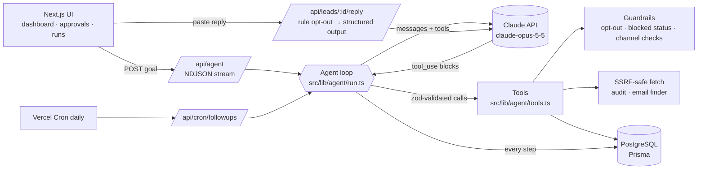

# LeadPilot AI

**An AI sales agent for local-business outreach.** Give it a goal in plain English. It audits websites, finds contact emails, scores leads and drafts personalised outreach using **Claude tool use** against a Postgres CRM. Every message waits for a human to approve it.


<!-- Record a 20-30s GIF: run the "Research & draft" preset, show the live trace, then approve a draft. Save it as docs/demo.gif -->

## The problem

Small web studios and agencies that sell websites and automation to local businesses spend hours on the same loop: find a business, check its website, hunt for an email, decide whether it's worth contacting, write a message that doesn't sound like a template, and remember to follow up. Most of that is research and writing, which an LLM agent can do well. The risky parts, sending and opt-outs, stay with a human and with hard-coded rules.

## What it does

- **Agent console:** describe a goal ("research every unscored lead and draft outreach for the hot ones") and watch the agent work live: its reasoning summaries, each tool call with arguments, and each result.
- **8 tools** over real data: search leads, read a lead, **audit a website** (HTTPS, speed, mobile viewport, WhatsApp button, form, tap-to-call, title), **find a contact email** (handles `name [at] site [dot] com` and Cloudflare-obfuscated addresses, plus an MX check), **score** (0-100, Hot/Warm/Cold), **draft outreach**, update status, and optionally **discover businesses** through the Google Places API.
- **Human-in-the-loop approvals:** drafts can be edited, approved or rejected, then opened in Email, WhatsApp or Instagram. Confirming a send starts the follow-up timer.
- **Reply triage with structured outputs:** paste a reply. A single schema-validated Claude call classifies the intent, moves the lead in the pipeline and suggests an answer.
- **Automated follow-ups:** a daily Vercel Cron job closes stale leads as *No Response* and runs the agent to draft Day 3 and Day 7 follow-ups that don't repeat the first message.
- **Replayable runs:** every agent step is stored, so any run can be opened and inspected later.

## Architecture



## How the agent works

`src/lib/agent/run.ts` is a hand-written Messages API tool-use loop (no framework):

1. Send the goal, the system prompt and the tool definitions to Claude (`claude-opus-5-5`, adaptive thinking, `effort: "medium"`, prompt caching on).
2. If Claude stops with `tool_use`, run **every** requested tool. Parallel calls run concurrently and **all results go back in one user message**.
3. Append the full assistant content (thinking blocks included, unchanged), then repeat until `end_turn`. `pause_turn`, `max_tokens` and `refusal` are handled explicitly, and server-side refusal fallbacks are enabled.
4. Each step (thinking summary, text, tool call, tool result) is streamed to the browser as NDJSON and saved to `AgentStep`.

**Tool design.** Each tool is a zod schema plus a description plus an executor. Schemas become JSON Schema sent with `strict: true` and are validated again with zod before running. A tool error is returned to Claude as `is_error: true` with a readable reason, so it can adapt instead of crashing.

**Safety lives in code, not in the prompt.** `src/lib/leads/guardrails.ts` blocks outreach to opted-out, lost or bounced leads, to landlines on WhatsApp, and to guessed emails. Opt-out replies ("stop", "unsubscribe") are caught by a rule **before** any model call and cancel pending drafts. Guardrails are checked again when a message is approved. Website fetching rejects private, loopback and link-local addresses on every redirect hop (SSRF protection). The agent cannot send anything.

**Agent vs. single call.** Lead research is open-ended, so it uses the agent. Reply triage is a fixed task, so it uses one `messages.parse` call with a zod output schema, which is cheaper and more predictable.

## Tech stack

Next.js 16 (App Router, Cache Components) · TypeScript · Tailwind CSS 4 · PostgreSQL · Prisma 7 (`@prisma/adapter-pg`) · Anthropic TypeScript SDK · zod 4 · libphonenumber-js · Vercel (hosting and cron)

## Run it locally

Requirements: Node 20+ and either Docker or a local Postgres.

```bash
git clone https://github.com/iluckyvirani/leadpilot-ai.git
cd leadpilot-ai
npm install
cp .env.example .env              # then set ANTHROPIC_API_KEY
docker compose up -d              # Postgres on port 5433
#   no Docker? run `npm run db:local` in a second terminal (embedded PGlite on port 5433)
#   and add ?sslmode=disable to DATABASE_URL
npm run db:migrate
npm run db:seed                   # 11 fictional demo businesses
npm run dev                       # http://localhost:3000
```

### Demo mode (no API key, no credits)

If `ANTHROPIC_API_KEY` is empty (or `DEMO_MODE="true"`), the agent runs with a scripted stand-in for Claude (`src/lib/agent/demo.ts`). The real agent loop, tools, guardrails, database and UI all run; only the model's decisions are scripted, and reply triage uses simple rules. The trace is labelled "demo". Add a key to switch to real Claude automatically.

### Use a free provider instead of Claude

The loop also runs on any OpenAI-compatible API through a small adapter (`src/lib/agent/provider.ts`). Leave `ANTHROPIC_API_KEY` empty and set, for example:

```bash
# Gemini (free tier)          # Groq (free tier)                       # Ollama (local, no key)
OPENAI_API_KEY="..."          OPENAI_API_KEY="..."                      OPENAI_BASE_URL="http://localhost:11434/v1"
OPENAI_BASE_URL="https://generativelanguage.googleapis.com/v1beta/openai"   OPENAI_MODEL="llama3.1"
OPENAI_MODEL="gemini-3.5-flash-lite"
```

Provider order: `DEMO_MODE` > `LLM_PROVIDER` > Anthropic key > OpenAI-compatible > demo. Smaller models are weaker at tool use than Claude; reply triage uses JSON mode there. `npm run smoke:openai` tests the adapter against a mock server.

Offline check, with no API key needed (a scripted fake Claude drives the real loop, tools and DB):

```bash
npm run smoke
```

## Environment variables

| Variable | Required | Purpose |
|---|---|---|
| `DATABASE_URL` | yes | Postgres connection string |
| `ANTHROPIC_API_KEY` | for real Claude | Claude API key. Empty = demo mode |
| `ANTHROPIC_MODEL` | no | Defaults to `claude-opus-5-5` |
| `LLM_PROVIDER`, `OPENAI_API_KEY`, `OPENAI_BASE_URL`, `OPENAI_MODEL` | no | Optional OpenAI-compatible provider (Gemini, Groq, Ollama, OpenAI) |
| `SENDER_NAME`, `SENDER_COMPANY`, `SENDER_OFFER`, `PORTFOLIO_URL`, `BOOKING_URL` | no | Who the outreach is from; used in the system prompt |
| `GOOGLE_PLACES_API_KEY` | no | Turns on the `find_new_businesses` tool |
| `GUESS_EMAILS` / `ALLOW_GUESSED_EMAILS` | no | Store `info@domain` guesses / allow drafting to them (off by default) |
| `APP_PASSWORD` | strongly recommended when deployed | HTTP Basic auth for the whole app |
| `CRON_SECRET` | for cron | Bearer token Vercel Cron sends to `/api/cron/followups` |

See `.env.example`. Never commit `.env`.

## Project structure

```
src/lib/agent/    run.ts (loop) · tools.ts · prompt.ts · triage.ts · followups.ts
src/lib/leads/    audit · emails · score · guardrails · phone · places · safe-fetch
src/app/          dashboard, approvals, runs, lead pages + API routes
prisma/           schema, migrations, seed
scripts/          agent-smoke.ts (offline test)
```

## Responsible use

LeadPilot drafts. People send. It respects opt-outs immediately, never emails guessed addresses by default, only reads public business pages, and doesn't scrape sites whose terms forbid it. If you send email, follow the anti-spam law where you are (for example UK PECR/GDPR, CAN-SPAM) and include your real business address.

## Roadmap

- Expose the tools as an MCP server so the agent can be used from Claude Desktop
- SMTP/IMAP and WhatsApp Business API integrations, behind the same approval step
- Evals for draft quality and triage accuracy

## License

MIT
